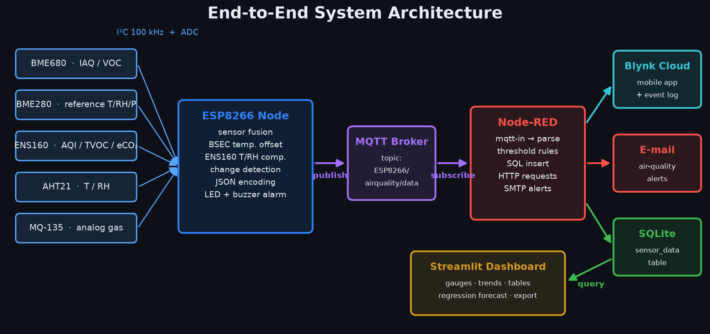
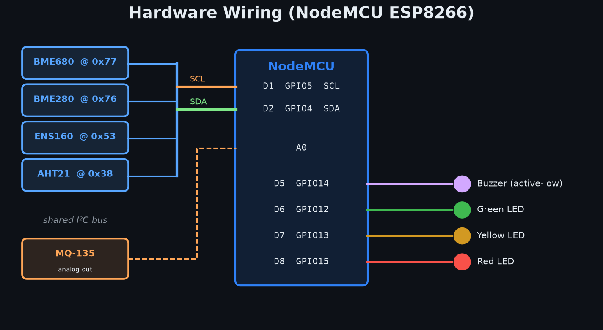
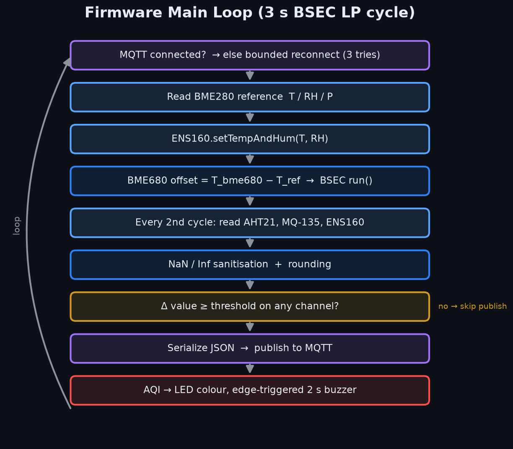
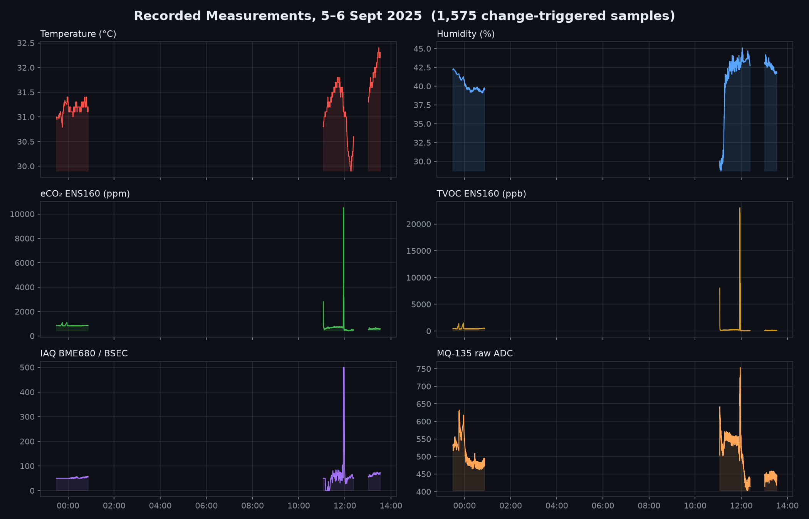
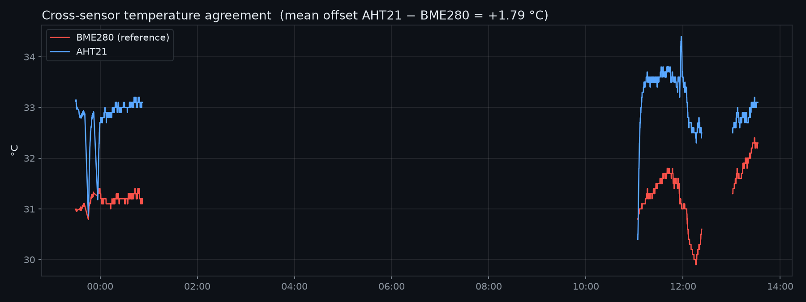
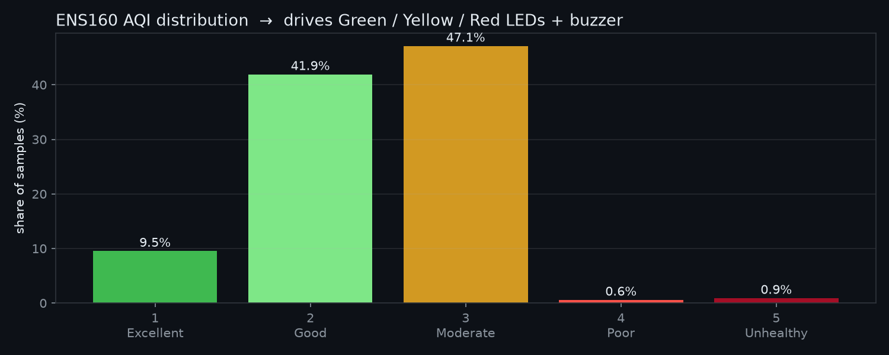

# Indoor Air Quality Monitor (ESP8266, MQTT, Node-RED)

My final project for the Internet of Things course at the University of Kashan.
Sina Mozaffari Rad, student ID 40021160214.

I built a small air-quality station from five cheap sensors and an ESP8266, and then the software around it:
the board sends readings over MQTT, Node-RED stores them and sends alerts, and a Streamlit app shows the
history and makes a simple forecast. I wanted to go through every layer myself, from the I²C wiring up to the
dashboard, not only one part of it.

<p align="center"></p>

## Hardware

<p align="center"></p>

| Part | Bus / pin | What I use it for |
|------|-----------|-------------------|
| NodeMCU ESP8266 | — | MCU and Wi-Fi |
| Bosch BME680 | I²C `0x77` | IAQ, CO₂-equivalent and breath-VOC through Bosch BSEC |
| Bosch BME280 | I²C `0x76` | Reference temperature, humidity and pressure |
| ScioSense ENS160 | I²C `0x53` | AQI (1–5), TVOC, eCO₂ |
| AHT21 | I²C `0x38` | Second temperature / humidity reading |
| MQ-135 | `A0` | Raw gas level |
| Green / yellow / red LED | `D6 / D7 / D8` | Air quality at a glance |
| Buzzer (active-low) | `D5` | Alarm |

The four digital sensors share one I²C bus (SDA `D2`, SCL `D1`). I run it at 100 kHz to keep it stable over
jumper wires. Before putting everything together I tested each sensor alone; those
sketches are in `sensor-tests/`, including the R₀ calibration of the MQ-135 in clean air and its ppm curve.

## Firmware

<p align="center"></p>

The main problem I had was that the BME680 heats itself (it has a hot plate for the gas measurement), so its
temperature is too high and the humidity correction inside BSEC goes wrong. My fix was to use the BME280 as a
reference: every cycle the code calculates `T_BME680 − T_BME280` and gives it to BSEC with
`setTemperatureOffset()`. I also give the BME280 temperature and humidity to the ENS160 with `setTempAndHum()`,
so both gas sensors are corrected from the same reference.

To not flood the broker, the board only publishes when a value really changes. Each of the 13 channels has its
own threshold:

| Channel | Threshold | Channel | Threshold |
|---------|-----------|---------|-----------|
| Temperature | 0.1 °C | IAQ / static IAQ | 5 |
| Humidity | 1 % RH | CO₂-equivalent | 5 ppm |
| Pressure | 2 hPa | ENS160 eCO₂ | 5 ppm |
| MQ-135 | 10 ADC counts | ENS160 TVOC | 10 ppb |
| ENS160 AQI | 1 level | Breath-VOC | 0.1 ppm |

The shortest interval is 6 s, because that is the BSEC low-power sample period.

Some smaller things I had to handle:
- BSEC sometimes returns NaN or Inf, which breaks the JSON, so I check every value before sending it.
- The 13-field message did not fit in the default PubSubClient buffer, so I increased it to 1 KB.
- MQTT reconnect tries three times, and prints the PubSubClient error code as text so I could debug it.
- The buzzer is driven with `millis()` and only beeps when the AQI goes into "poor", so it does not block the
  sensor loop.

## MQTT message

The board publishes to `ESP8266/airquality/data` (QoS 0). One real message:

```json
{
  "temperature": 32.3, "humidity": 41.9, "pressure": 863.8,
  "mq135_value": 447,
  "iaq": 72.95, "static_iaq": 74.26, "co2_equivalent": 742.61, "breath_voc": 0.87,
  "temp_aht": 33.1, "hum_aht": 44.8,
  "aqi_ens": 2, "tvoc_ens": 126, "eco2_ens": 591
}
```

## Node-RED

The flow in [`node-red/flow.json`](node-red/flow.json):

1. subscribes to the topic and parses the JSON,
2. saves every message in an SQLite table (`sensor_data`) with a timestamp,
3. sends an e-mail when ENS160 AQI ≥ 4, eCO₂ ≥ 1000 ppm or MQ-135 ≥ 990,
4. pushes the values to 10 Blynk virtual pins, so I can also see them on my phone.

## Dashboard

[`dashboard/app.py`](dashboard/app.py) is a Streamlit app on top of the SQLite file. It has live gauges, trend
charts, a data table with a date filter, CSV / JSON export, and a forecast page. The forecast is a linear
regression on time features (hour of day as sin/cos, lag values and rolling means) for up to 24 h ahead. It is
simple on purpose; the goal was to have the full pipeline working, not the best model.

## Results

These are real readings from 5–6 September 2025 ([`data/sample_24h_readings.json`](data/sample_24h_readings.json)).
The gaps are times when the board was off.

<p align="center"></p>

The interesting part is around 12:00: the ENS160, the BME680 and the MQ-135 all jump at the same moment. They
use different sensing methods, so seeing them agree gave me some trust in the whole setup.

<p align="center"></p>

<p align="center"></p>

## What I learned and what I would change

- Sensors that look fine on their own can disturb each other when they sit together (the self-heating of the
  BME680 was the clearest case). Having one trusted reference sensor made the rest much easier.
- Sending only on change saved a lot of traffic, but choosing the thresholds was mostly trial and error. Next
  time I would pick them from the noise level of each sensor.
- The system uses a public broker with no login or TLS. That was fine for a course project, but a real
  device needs its own broker and authentication.
- Apart from the MQ-135, I did not calibrate the sensors against a reference instrument, so the absolute values
  should not be trusted too much. The trends are more reliable.

## Repository structure

```
firmware/AirQualityNode/      Final ESP8266 firmware
sensor-tests/                 Tests I did for each sensor before integration
  ├─ bme280test/              BME280 alone
  ├─ Rzero/                   MQ-135 R0 calibration
  ├─ ppm/                     MQ-135 ppm conversion
  ├─ test3HW/                 Three sensors together
  └─ fulltest/                Full hardware test
node-red/flow.json            Node-RED flow
dashboard/                    Streamlit app
data/                         Recorded data
docs/
  ├─ IOT_FinalProject_40021160214.pdf   Project report
  ├─ make_figures.py          Script that draws the figures in this README
  └─ figures/
```

## How to run it

**Firmware:** Arduino IDE with the ESP8266 core and these libraries: `Adafruit AHTX0`, `Adafruit BME280`,
`Adafruit Unified Sensor`, `DFRobot_ENS160`, `BSEC Software Library`, `PubSubClient`, `ArduinoJson`.
Put your Wi-Fi name and password in `firmware/AirQualityNode/AirQualityNode.ino` and upload it.

**Node-RED:** install `node-red-node-sqlite` and `node-red-node-email`, import `node-red/flow.json`, and add
your own Blynk token and e-mail address.

**Dashboard:**
```bash
cd dashboard
pip install -r requirements.txt
SENSOR_DB_PATH=/path/to/sensor_data.db streamlit run app.py
```

**Figures:**
```bash
pip install matplotlib pandas
python docs/make_figures.py
```
